# AGI-Movie Recommendation Hub

**MLOps · Year 5, Semester 1.** AI-powered movie recommendations.

Original project ZIP: [g15-master.zip](archive/g15-master.zip).

PSIA group 15's movie recommendation app. Users can register, log in, browse movies and profiles, and manage watched history and watchlists. Recommendation filters, stored results, and agent context APIs are available. User-requested recommendations can use Qwen2.5-0.5B-Instruct, a quantized model served on CPU by `llama.cpp` inside the cluster, and fall back to a deterministic ranking if inference fails. A Kubernetes CronJob (the background agent) runs every three minutes and queues recommendations for users who need a refresh; user-requested jobs are always claimed first. Those automatic recommendations currently use the deterministic selection only, because `AUTO_INFERENCE_ENABLED=false` (CPU inference takes roughly 10 to 70 seconds per request). Tests, image builds and production deployment run in GitLab CI/CD (see [GitLab CI/CD setup](#gitlab-cicd-setup)).

This guide covers [local setup](#1-install-requirements) and [deployment on Google Cloud](#deploy-on-google-cloud). Deployment uses self-hosted Kubernetes on virtual machines. The [infrastructure guide](infra/README.md) also covers local KVM/libvirt clusters.

## 1. Install requirements

Use a Linux development environment, such as Ubuntu or Ubuntu on WSL. Install:

| Tool | Version / purpose |
| --- | --- |
| Git | Clone the repository |
| Python | 3.12, with `venv` and pip support |
| Node.js | 24.15 or newer within Node 24, with npm |
| Docker | Running daemon, accessible by your user |
| Docker Compose | Plugin v2.20 or newer |
| Nginx | Local reverse proxy; installation option below |
| VS Code | Optional, for the provided launch tasks |

Docker runs the three PostgreSQL databases. Python services, Angular, and Nginx run on the host.

If you use nvm, install the project's Node version:

```sh
nvm install 24
nvm use 24
```

Check the tools before continuing:

```sh
python3.12 --version
node --version
npm --version
docker compose version
docker info
```

On Ubuntu, you can install a local copy of Nginx after cloning, using step 4. A system-installed Nginx also works.

## 2. Clone the repository

```sh
git clone https://gitlab.rnl.tecnico.ulisboa.pt/psia/groups26/g15.git
cd g15
```

Run all commands below from this repository root. If already cloned, open the existing checkout.

## 3. Create configuration and install dependencies

Copy each service's example config. Existing `.env` files are kept:

```sh
for service in movie-service recommendation-service user-service; do
  if [ ! -f "app/backend/$service/.env" ]; then
    cp "app/backend/$service/.env.example" "app/backend/$service/.env"
  fi
done
```

Install backend dependencies into separate Python environments:

```sh
for service in movie-service recommendation-service user-service; do
  python3.12 -m venv "app/backend/$service/.venv"
  "app/backend/$service/.venv/bin/python" -m pip install \
    -r "app/backend/$service/requirements.lock"
  "app/backend/$service/.venv/bin/python" -m pip install -e app/backend/common
done
```

Install frontend dependencies with the project's Node helper:

```sh
sh app/frontend/scripts/with-node.sh npm ci
```

Each backend owns its `.env`; there is no root `.env`. The examples contain local database settings. If you change a database password or port, also update that service's `DATABASE_URL`. Local `.env` files are ignored by Git. Restart services after changing settings.

For service-to-service features, set matching tokens in these files. Generate a separate value for each row, for example with `python3.12 -c 'import secrets; print(secrets.token_hex(32))'`:

| Setting | Files that must share the same value | Purpose |
| --- | --- | --- |
| `RECOMMENDATION_API_TOKEN` | User + Recommendation `.env` | Access stored recommendations |
| `AGENT_CONTEXT_TOKEN` | User + Recommendation `.env` | Private agent context access |
| `WATCHED_CLEANUP_TOKEN` | Movie + User `.env` | Clean watched history during catalog reset |

Optional Movie Service settings:

- `TMDB_READ_TOKEN`: needed to import movies from TMDB in step 7.
- `MOVIE_WRITE_TOKEN`: needed for authenticated movie writes through the API.

Keep reset endpoints disabled for normal use. Reset setup is linked in step 8.

## 4. Set up Nginx

If Nginx is already installed, skip this step. On Ubuntu, install a local copy without sudo:

```sh
sh app/proxy/scripts/setup/install.sh
```

It stores Nginx in the proxy's ignored `.runtime/` directory. The launcher supports this copy or a system installation.

## 5. Start the app

### With VS Code

Open the repository folder. Run **Tasks: Run Task → run: app** from the Command Palette.

This starts the databases, three Flask services, Angular, and Nginx in dedicated terminal panels. Each backend initializes its own database schema at startup.

Useful individual tasks: `run: databases`, `run: services`, `run: frontend`, and `run: proxy`. Re-running a component task restarts its task-managed process. Database tasks recreate containers while keeping their volumes.

### With terminals

Start the databases and wait for them to become healthy:

```sh
docker compose up -d --wait
```

Then run each command below in its own terminal, from the repository root:

```sh
# Terminal 1
sh app/backend/movie-service/scripts/development/run.sh

# Terminal 2
sh app/backend/recommendation-service/scripts/development/run.sh

# Terminal 3
sh app/backend/user-service/scripts/development/run.sh

# Terminal 4
sh app/frontend/scripts/development/run.sh

# Terminal 5
sh app/proxy/scripts/development/run.sh
```

Use either the VS Code tasks or direct launch commands for a component. Stop directly launched processes before switching to tasks.

## 6. Open and check the app

Open **http://127.0.0.1:4205** and register an account. A fresh database has no movie catalog; import movies in step 7.

Open **http://127.0.0.1:4205/health** to check connections, or run:

```sh
curl --fail http://127.0.0.1:4205/api/movie/health
curl --fail http://127.0.0.1:4205/api/recommendation/health
curl --fail http://127.0.0.1:4205/api/user/health
```

Each response includes service and database status. HTTP 503 means its database is unavailable.

| Component | Local port |
| --- | --- |
| Nginx / app entrypoint | 4205 |
| Angular development server | 4204 |
| Movie Service | 4206 |
| Recommendation Service | 4207 |
| User Service | 4208 |
| Movie DB | 5433 |
| Recommendation DB | 5434 |
| User DB | 5435 |

Angular is also available at http://127.0.0.1:4204 with its development API proxy.

## 7. Add movies and sample users

For movie import, set `TMDB_READ_TOKEN` in `app/backend/movie-service/.env` to your TMDB API read access token.

In VS Code, run **Tasks: Run Task → ingest: movies** and choose how many new movies to add. Or, with the services running:

```sh
sh app/backend/movie-service/db/ingestion/movies.sh --count 100
```

To import movies followed by sample users, use **ingest: all**, or:

```sh
# 100 new movies, 1000 users, up to 10 watched and 10 watchlist movies per user
sh app/backend/common/scripts/ingestion/ingest-all.sh 100 1000 10 10
```

Ingestion tasks start missing backend dependencies and reuse running ones. Direct CLI commands need the services and databases running first. Movie import keeps existing movies; another run adds new ones. Posters are stored locally, and the running app uses only local catalog data.

Sample user import creates a development account: `admin@admin.com` / `admin`. Generated sample credentials are saved in the ignored `app/backend/user-service/.run/ingestion-users.csv`. Use these accounts only for local development. Watched and watchlist movies do not overlap.

See [movie import and offline JSON input](app/backend/movie-service/db/ingestion/README.md) and [sample user import](app/backend/user-service/db/ingestion/README.md) for details.

## 8. Stop, restart, or clear data

For a task-managed app, run **stop: app** in VS Code or:

```sh
sh scripts/development/stop-app.sh
```

For direct terminal launches, press Ctrl+C in each app terminal, then stop the databases:

```sh
docker compose down
```

Both approaches keep database volumes. Start again using step 5.

To stop one task-managed component:

```sh
python3 scripts/development/manage-component.py stop frontend
```

Other component names: `proxy`, `movie`, `recommendation`, `user`. Processes started by ingestion tasks are also managed; their logs are in the service's `.run/ensure.log`.

To intentionally clear application data, configure the service-local reset tokens and enabled flags described in [reset coordination](app/backend/movie-service/README.md#reset-with-watched-history-cleanup). Then use `clear: all`, or an individual `clear: movie`, `clear: user`, or `clear: recommendation` task. `clear: all` clears Recommendation, Movie, then User data while keeping schema and reset coordination records. Movie reset also coordinates watched-history cleanup.

For individual database operations, use the service's Compose file and `.env`, as described in [application layout](app/README.md). Avoid `--remove-orphans` on an individual file: all databases share one Compose project.

## 9. Run checks

Build the frontend:

```sh
sh app/frontend/scripts/with-node.sh npm run build
```

For tests, install the locked test dependencies once:

```sh
for component in common movie-service recommendation-service user-service; do
  python3.12 -m venv "app/backend/$component/.venv"
  "app/backend/$component/.venv/bin/python" -m pip install \
    -r "app/backend/$component/requirements-test.lock"
  "app/backend/$component/.venv/bin/python" -m pip install -e app/backend/common
done
sh app/frontend/scripts/with-node.sh npm ci --include=dev
```

Run **test: all** in VS Code, or:

```sh
sh scripts/testing/run-tests.sh
```

This runs six suites: root scripts, shared backend library, three backend services, and frontend. The runner reports coverage totals; component runners show per-file coverage. Tests need no running app or databases.

Documentation checks:

```sh
python3 scripts/validation/validate_methodology.py --root .
sh agents/plugins/forge/skills/initialize-project/scripts/project-docs.sh validate .
git diff --check
```

## Deploy on Google Cloud

The app currently has one cloud demo environment. The steps below cover the **initial** deployment: provisioning the VMs, the cluster, the platform services and the first application install, all done by hand with Terraform, Ansible and `kubectl`. **Later updates** are deployed by GitLab CI/CD from the `master` branch (see [GitLab CI/CD setup](#gitlab-cicd-setup)); do not repeat the manual steps for routine updates.

This path creates three Compute Engine VMs and installs Kubernetes with kubeadm. Managed Kubernetes is forbidden by the course assignment. Terraform owns the VMs and platform services; Ansible installs the cluster; Kustomize deploys the app.

For the existing Movie Recommendation System deployment, use the saved variables and state paths in the [operator setup](infra/README.md#movie-recommendation-system-cloud-deployment). The steps below describe a fresh setup; do not create new state for an existing cluster.

Run these commands from the repository root, in the same shell. The defaults create one control-plane VM and two workers in Madrid, each an `e2-standard-2` instance with 2 vCPUs and 8 GiB of memory (the local libvirt layer defaults to 2 GiB VMs). Cloud resources incur charges while provisioned.

### 1. Prepare cloud access

Install Terraform >= 1.9, Ansible, kubectl, Docker, and the Google Cloud CLI on your Linux host. Have these ready:

- A Google Cloud project with billing and the Compute Engine API enabled.
- Google Application Default Credentials for Terraform, with permission to manage Compute Engine instances, networks, firewall rules, and addresses in that project.
- An SSH key pair at `~/.ssh/id_ed25519` and `~/.ssh/id_ed25519.pub`, or adjust the paths below and in the Ansible inventory.
- Your current public IPv4 address. The firewall allows SSH, Kubernetes API access, and the demo port only from this address.

Set the project and operator address. Replace both example values:

```sh
export TF_VAR_project='YOUR_GOOGLE_CLOUD_PROJECT_ID'
export TF_VAR_operator_cidr='YOUR_PUBLIC_IPV4/32'
export TF_VAR_ssh_public_key="$(cat ~/.ssh/id_ed25519.pub)"
```

If your public IP changes, update `TF_VAR_operator_cidr` and apply the cluster layer again. Team admin IPs are configured in `additional_operator_cidrs` in `infra/terraform/cluster-gcp/variables.tf`, or through `TF_VAR_additional_operator_cidrs` as a JSON list of IPv4 `/32` ranges. They get the same network access as `operator_cidr`: SSH (22), Kubernetes API (6443), and the app (30080). SSH keys and Kubernetes credentials are still required. Use `app_client_cidrs` for extra IPs that only need the app.

### 2. Create the VMs and Kubernetes cluster

```sh
terraform -chdir=infra/terraform/cluster-gcp init
sh infra/terraform/tf-apply.sh infra/terraform/cluster-gcp
terraform -chdir=infra/terraform/cluster-gcp output
```

Create `infra/ansible/inventory.gcp.ini` from the example if it does not exist:

```sh
if [ ! -f infra/ansible/inventory.gcp.ini ]; then
  cp infra/ansible/inventory.example.ini infra/ansible/inventory.gcp.ini
fi
```

Edit its three `ansible_host` values using the **external** IPs from Terraform's `control_plane_ips` and `worker_ips` outputs. Keep the inventory names `g15-cp1`, `g15-worker1`, and `g15-worker2`. Check SSH access, then run the playbook:

```sh
ansible -i infra/ansible/inventory.gcp.ini kubernetes -m ping
ansible-playbook -i infra/ansible/inventory.gcp.ini infra/ansible/site.yaml \
  -e apiserver_advertise_address=10.42.42.10 \
  -e kubeconfig_output="$PWD/infra/terraform/cluster-gcp/kubeconfig.out"

export KUBECONFIG="$PWD/infra/terraform/cluster-gcp/kubeconfig.out"
kubectl wait --for=condition=Ready nodes --all --timeout=300s
kubectl get nodes
```

The advertise address is the control plane's **internal** IP, `10.42.42.10` with the default Terraform settings. If you changed it, use the `control_plane_internal_ips` output. The playbook configures external operator access in the API certificate and fetched kubeconfig.

### 3. Build and copy application images

This step is only needed for the initial install: the manifests start with locally built `g15-*:local` images and `imagePullPolicy: Never`. Once the CD pipeline has deployed a component, that Deployment runs an immutable image from the GitLab Container Registry (`<registry>/<component>@sha256:<digest>`) and is managed by the pipeline, not by these commands.

Build the five images on the host. Use a Docker build host targeting the cluster's Linux amd64 architecture:

```sh
for service in movie-service recommendation-service user-service; do
  docker build --platform linux/amd64 \
    -f "app/backend/$service/Dockerfile" -t "g15-$service:local" .
done
docker build --platform linux/amd64 -f app/frontend/Dockerfile -t g15-frontend:local .
docker build --platform linux/amd64 -f app/proxy/Dockerfile -t g15-proxy:local .
```

Deployments use `imagePullPolicy: Never`, so import each image into containerd on **all three nodes** before deploying. Save one image per archive:

```sh
for component in movie-service recommendation-service user-service frontend proxy; do
  docker save -o "/tmp/g15-$component.tar" "g15-$component:local"
  ansible -i infra/ansible/inventory.gcp.ini kubernetes \
    -m copy -a "src=/tmp/g15-$component.tar dest=/tmp/g15-$component.tar"
  ansible -i infra/ansible/inventory.gcp.ini kubernetes -b \
    -a "ctr -n k8s.io images import /tmp/g15-$component.tar"
done
```

GCE nodes pull upstream images directly. Local KVM nodes may also need upstream images imported; see the [image distribution guide](infra/k8s/app/README.md#2-distribute-images-no-registry).

### 4. Configure secrets, storage, and platform services

Create the deployment secret file if missing:

```sh
if [ ! -f infra/k8s/app/db-passwords.env ]; then
  cp infra/k8s/app/db-passwords.env.example infra/k8s/app/db-passwords.env
fi
```

Edit `infra/k8s/app/db-passwords.env`. Replace all example values with real database passwords and a shared `RECOMMENDATION_API_TOKEN`. This ignored file configures Kubernetes; local service `.env` files are not loaded by the deployment. On an existing deployment, keep its database passwords: changing the Secret does not update passwords inside an initialized PostgreSQL volume.

Install local-path storage:

```sh
kubectl apply -f https://raw.githubusercontent.com/rancher/local-path-provisioner/v0.0.31/deploy/local-path-storage.yaml
kubectl -n local-path-storage rollout status deployment/local-path-provisioner --timeout=300s
```

Keep the GCP app-layer state separate from the local-cluster state:

```sh
mkdir -p infra/terraform/app/.data-gcp
export G15_APP_STATE="$PWD/infra/terraform/app/.data-gcp/terraform.tfstate"
terraform -chdir=infra/terraform/app init
```

On the first deployment, install namespaces and Helm releases before applying the full layer. This makes the Prometheus CRDs available before Terraform plans the ServiceMonitor:

```sh
terraform -chdir=infra/terraform/app apply \
  -state="$G15_APP_STATE" \
  -var=kubeconfig_path=../cluster-gcp/kubeconfig.out \
  -target=kubernetes_namespace.app \
  -target=kubernetes_namespace.monitoring \
  -target=kubernetes_namespace.ingress \
  -target=helm_release.monitoring \
  -target=helm_release.loki \
  -target=helm_release.alloy \
  -target=helm_release.ingress

terraform -chdir=infra/terraform/app apply \
  -state="$G15_APP_STATE" \
  -var=kubeconfig_path=../cluster-gcp/kubeconfig.out
```

This installs ingress-nginx, Prometheus, Grafana, Loki, Alloy, and the service dashboard. Run Terraform operations one at a time and keep the same state path for later updates.

### 5. Deploy and open the app

For the operator-only HTTP demo, apply the demo overlay:

```sh
kubectl apply -k infra/k8s/overlays/demo
for database in movie-db recommendation-db user-db; do
  kubectl -n g15-app rollout status "statefulset/$database" --timeout=300s
done
for component in movie-service recommendation-service user-service frontend proxy; do
  kubectl -n g15-app rollout status "deployment/$component" --timeout=300s
done
kubectl -n g15-app get pods,svc,pvc
```

The overlay allows the login cookie over HTTP. The base manifests keep secure cookies; public access needs HTTPS and its ingress/firewall configuration. The current cloud firewall exposes the demo only to your operator IP.

Set `G15_NODE` to the control plane's external IP from Terraform, then check all three services:

```sh
export G15_NODE='YOUR_CONTROL_PLANE_EXTERNAL_IP'
for service in movie recommendation user; do
  curl --fail "http://$G15_NODE:30080/api/$service/health"
done
```

Open **http://YOUR_CONTROL_PLANE_EXTERNAL_IP:30080** and register an account. Fresh cloud databases have no local-development users or catalog data. Local ingestion commands in step 7 target the local environment; they do not automatically populate this cluster. The Qwen inference server (the `inference` Deployment) is part of the same manifests and downloads its model from Hugging Face into the `inference-models` volume on first start. The background agent CronJob ships **suspended**; activate it as described in the [application deployment guide](infra/k8s/app/README.md) after the controlled test described there. Automatic recommendations use the deterministic selection (`AUTO_INFERENCE_ENABLED=false`); only user-requested ones call Qwen.

For failed rollouts, inspect `kubectl -n g15-app get pods`, `kubectl -n g15-app describe pod POD_NAME`, and `kubectl -n g15-app logs POD_NAME`. `ErrImageNeverPull` usually means the image was not imported on the node running that pod.

### 6. Update or remove the deployment

Routine updates go through GitLab CI/CD (merge into `master`). The commands below are the manual path for the initial install, or for a cluster without CD: rebuild and import the changed images on every node, then reapply the same overlay. Since the `:local` tags stay the same, restart deployments to load the new images. Do not use this path on a cluster managed by CD: reapplying the overlay sets the image fields back to `g15-*:local`, which the deployment job then reports as drift.


```sh
kubectl apply -k infra/k8s/overlays/demo
kubectl -n g15-app rollout restart deployment
for component in movie-service recommendation-service user-service frontend proxy; do
  kubectl -n g15-app rollout status "deployment/$component" --timeout=300s
done
```

Database PVCs survive pod restarts. They are node-local storage, so back up required data before removing the cluster. Monitoring retention and storage limits are documented in the [monitoring guide](infra/k8s/monitoring/README.md).

To intentionally remove the cloud environment, destroy the app platform while the cluster is reachable, then destroy the VMs and networking. Use the same project variables and app state path as above:

```sh
terraform -chdir=infra/terraform/app destroy \
  -state="$G15_APP_STATE" \
  -var=kubeconfig_path=../cluster-gcp/kubeconfig.out
terraform -chdir=infra/terraform/cluster-gcp destroy
```

VM destruction removes the cluster's local data. Keep Terraform state files for the full lifecycle; deleting state files does not remove cloud resources. Use the commands above for infrastructure teardown.

## GitLab CI/CD setup

GitLab CI runs tests on pushes to `development` and `master`, including merges. Merge requests and feature branch pushes do not create pipelines. The `stage` branch was removed. On `master`, successful tests continue into image builds, publication and production deployment (see [Continuous delivery](#continuous-delivery-master-only)); on `development` only tests run.

The six test suites cover root scripts, the shared backend library, three backend services, and frontend. Python jobs use Python 3.12; frontend uses Node 24. Tests need no running app or databases. JUnit results appear in the pipeline's **Tests** tab. Reports and logs stay available as job artifacts for one week, including on failure.

The test runner runs inside the existing Kubernetes cluster (namespace `g15-ci`), up to two jobs at a time; two further runners, `g15-build` and `g15-deploy` (one job each), build images and deploy. See [runner setup and pipeline details](infra/ci-cd/README.md) for registration, token configuration, resource limits, and troubleshooting. Keep the test runner token in the ignored `infra/ci-cd/.env` file; the build and deploy runner tokens are typed at hidden prompts (see the [one-time CD setup](infra/ci-cd/README.md#initial-setup-of-continuous-deployment-once-per-cluster)).

### Branch rules

- Direct pushes to `development` and `master` are blocked. Use a feature branch and merge request.
- Who may merge into each branch is set in GitLab's protected-branch settings (Settings > Repository > Protected branches), not in this repository; check them there.
- Tests run after merge; no pipeline is required before merging. Force pushes are disabled.
- Protected branches stay after merge. Feature branches may be deleted after merge.

Open **CI/CD > Pipelines** to follow test jobs. If jobs stay pending, check runner availability, tags, and protected-branch restrictions.

### Continuous delivery (master only)

After the tests pass on a push to `master`, `infra/ci-cd/delivery.yml` continues the pipeline:

1. **Build**: Kaniko (unprivileged, on the `g15-build` runner) builds six images without pushing them: `frontend`, `proxy`, `user-service`, `movie-service`, `recommendation-service` and `ci-tools` (the tooling image the deploy job runs in).
2. **Publish**: Skopeo pushes each image to the GitLab Container Registry (`registry.rnl.tecnico.ulisboa.pt/psia/groups26/g15/<component>`) with the per-job token under the tag `sha-<commit>`. The pipeline records each image's SHA-256 manifest digest, and production only references `<component>@sha256:<digest>`.
3. **Dry-run**: `deploy:dry-run` runs automatically. It performs every check and server-side dry-run patches, and changes nothing.
4. **Deploy**: `deploy:production` runs on the `g15-deploy` runner. It starts automatically when the protected CI/CD variable `CD_AUTO_DEPLOY` is `true` (otherwise it is a manual job), and `CD_COMPONENTS` (protected, currently `all`) selects the components. A component whose sources did not change since its last deployment is skipped without a restart; a commit that changes none reports `nothing to deploy`. Components are updated in dependency order (movie, user, recommendation and the agent CronJob, proxy, frontend). The job holds a lock in the `cd-state` ConfigMap, refuses to run if the live images differ from the recorded state (drift) or if a newer commit exists on `master`, checks that every Pod runs exactly the published digest, is Ready and has not restarted, and rolls back automatically if anything fails. The deploy identity can only change the five Deployments and the agent CronJob (RBAC), and an admission policy limits those changes to the container image, pull policy and pull secret.
5. **Rollback**: `deploy:rollback` is a manual job that restores the state recorded before the last deployment.

The pipeline, its validation record and the one-time setup (runners, protected variables, registry pull credentials, the `cd-state` ConfigMap, activating the agent) are described in [`infra/ci-cd/README.md`](infra/ci-cd/README.md).

## Troubleshooting

| Problem | Check / fix |
| --- | --- |
| Node version error | Run `nvm install 24`; the frontend helper needs Node 24 installed. |
| Python environment cannot be created | Ensure Python 3.12 has `venv` support, then repeat step 3. |
| Docker connection or permission error | Start Docker and make sure your user can run `docker info`. |
| Compose cannot find config values | Create all three service `.env` files before starting databases. |
| Database unhealthy / API returns 503 | Run `docker compose ps` and `docker compose logs movie-db recommendation-db user-db`; check passwords and ports in `.env`. |
| Port already in use | Stop the existing component before starting another instance; check the port table in step 6. |
| Nginx missing | Run step 4 or install system Nginx. |
| Empty movie catalog | Import movies in step 7; check the Movie Service's `TMDB_READ_TOKEN`. |
| Recommendation or agent API rejects a request | Check the matching tokens in step 3 and restart both services. |
| No AI-generated recommendations | Automatic (background) recommendations use the deterministic selection by design (`AUTO_INFERENCE_ENABLED=false`). For user-requested ones, check that the `inference` Pod is Ready (it downloads its model on first start) and read the Recommendation Service logs; if inference fails, the deterministic fallback is used. |
| CI jobs stay pending | Check runner availability, tags, and protected-branch restrictions. |

## Demonstration, diagrams and screenshots

- Demonstration video: https://youtu.be/_0C-uUHVYyQ
- Evaluation scripts, raw results and the recommendation-latency experiment: [`infra/load/`](infra/load/README.md).

### Architecture

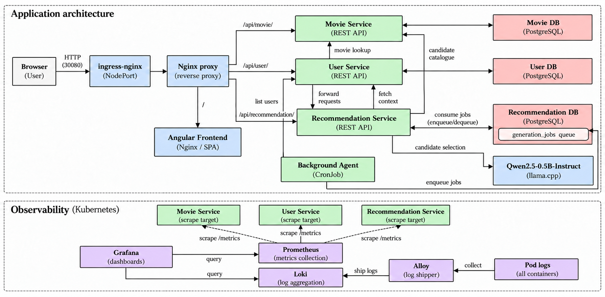

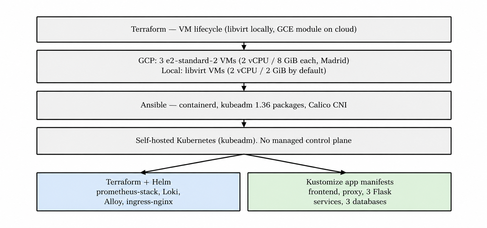

### Web interface

| | |
|---|---|
| 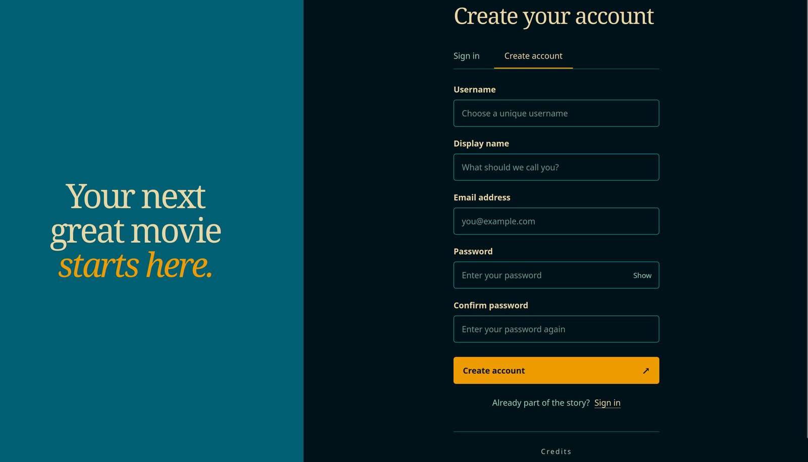 **Create account** | 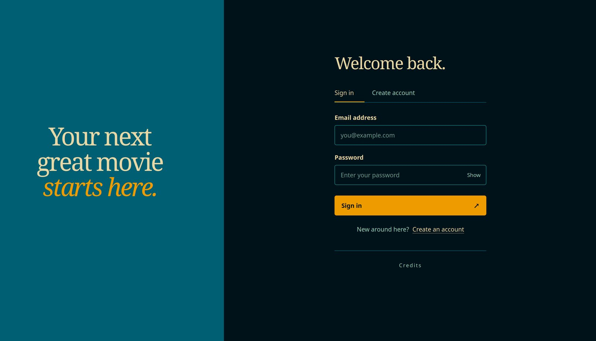 **Sign in** |
| 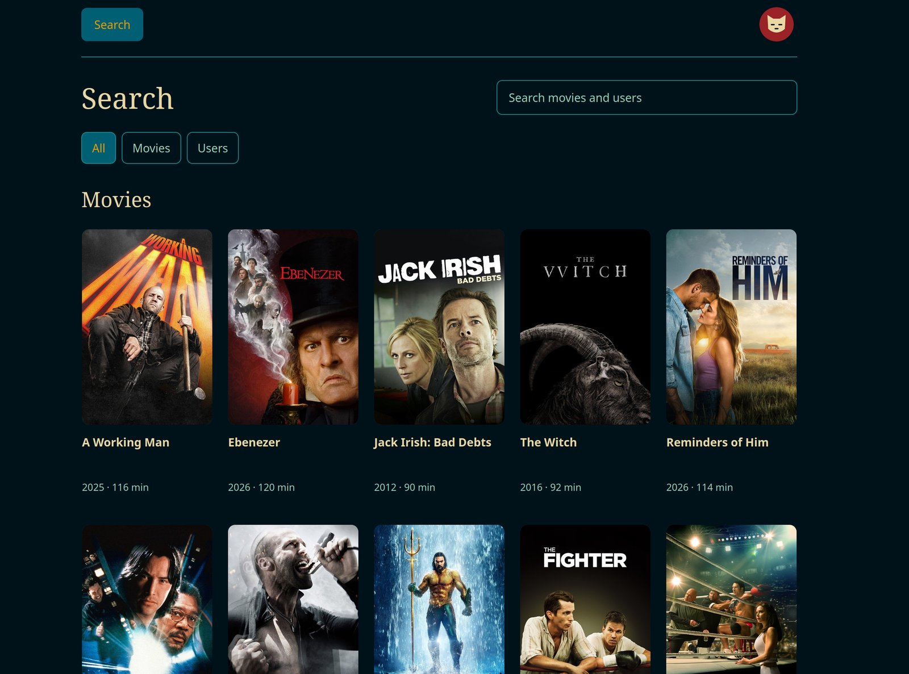 **Search: movies** | 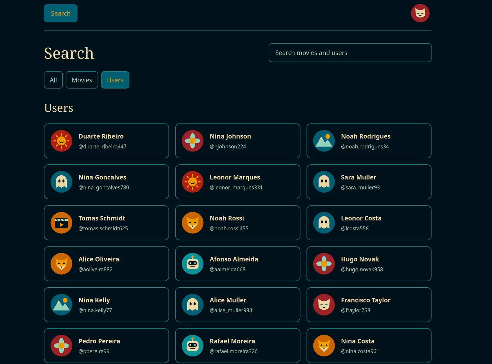 **Search: other users' public profiles** |
| 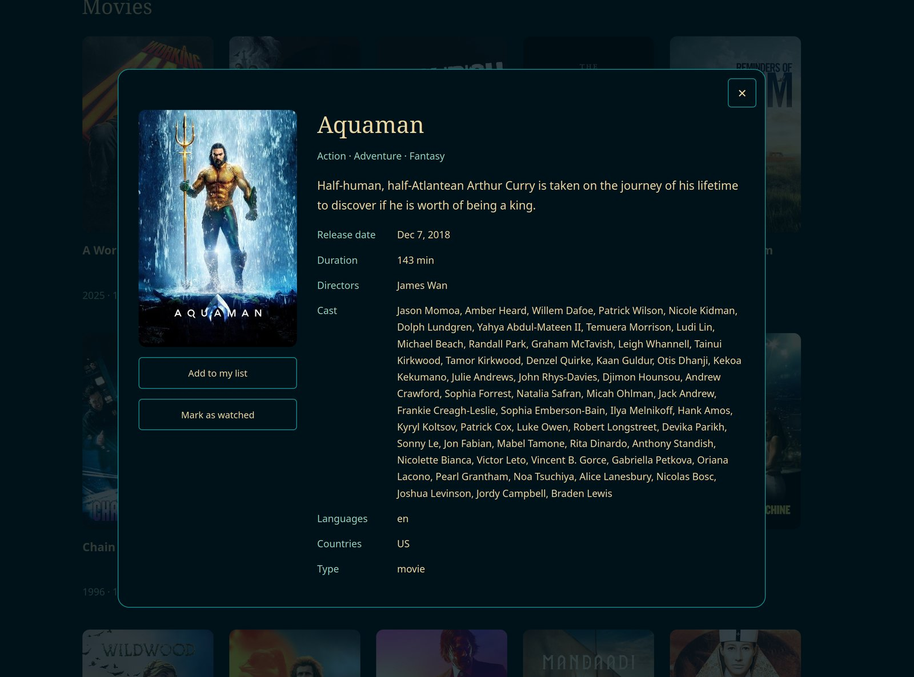 **Movie details, with "Add to my list" and "Mark as watched"** | 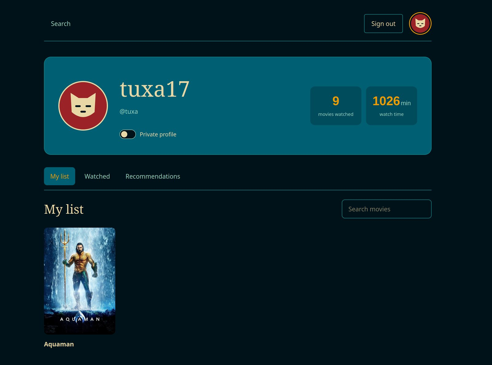 **Profile: my list, privacy switch and watch statistics** |
| 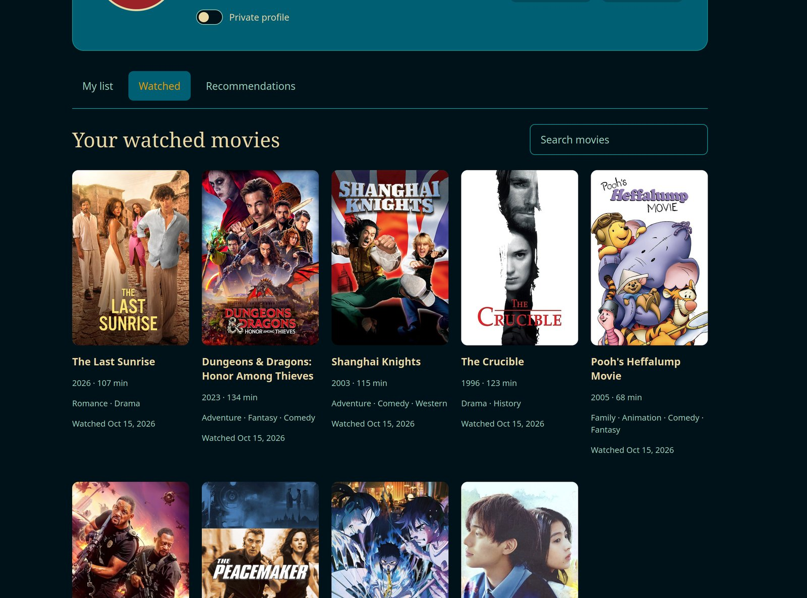 **Profile: watched history** | 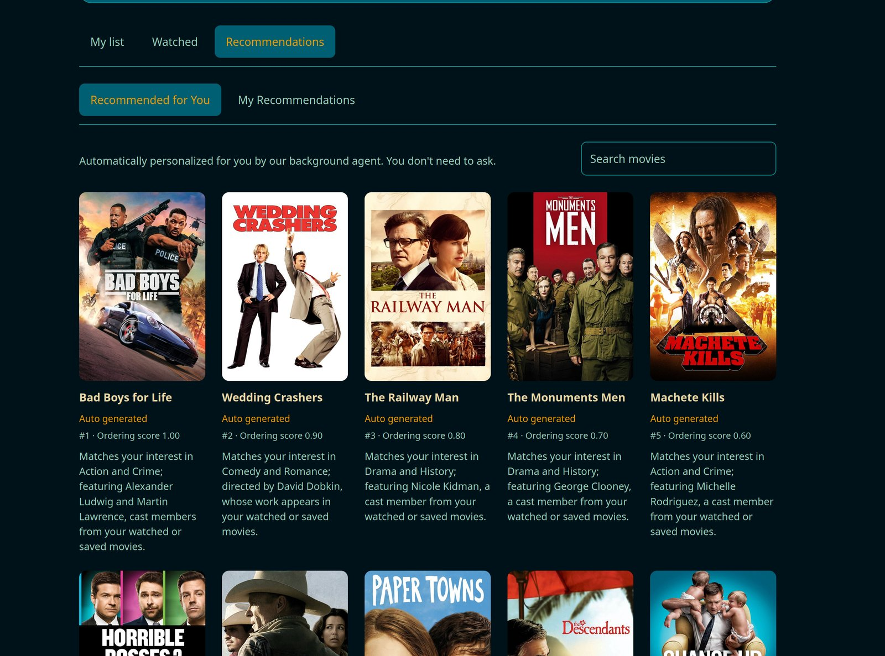 **Recommended for You: prepared in advance by the background agent** |
| 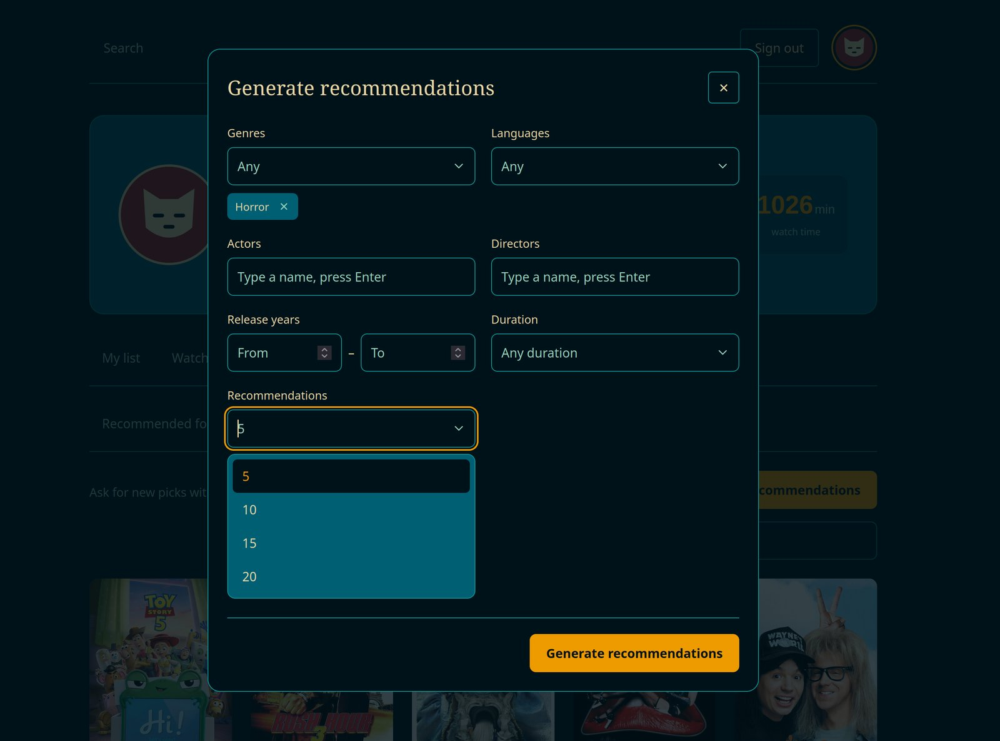 **Generate recommendations: filters (genres, languages, actors, directors, years, duration, count)** | 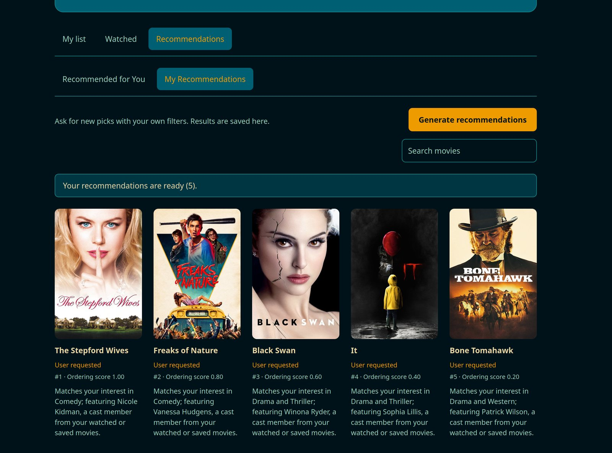 **My Recommendations: results of a user request, with explanations** |

### Load study

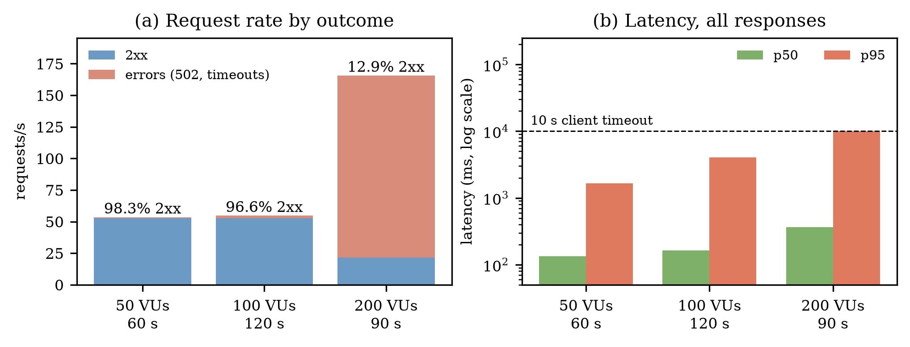

## Documentation

- [Application layout](app/README.md): components and service ownership.
- [Infrastructure](infra/README.md): self-hosted Kubernetes and Google Cloud setup.
- [Application deployment](infra/k8s/app/README.md): container images, secrets, and Kubernetes manifests.
- [Monitoring](infra/k8s/monitoring/README.md): metrics, logs, and dashboards.
- [Project specification](docs/project-spec.md): requirements, architecture, evaluation, and deliverables.
- [AI context](docs/ai-context.md): engineering facts and constraints.
- [Repository instructions](AGENTS.md) and [bootstrap](docs/bootstrap.md): contributor workflow.
- [Task workflow](docs/tasks/README.md) and [task selection](docs/TODO.md).
- [Forge setup and maintenance](agents/plugins/forge/README.md): plugin activation for Codex and Claude Code.

## Team and delivery

Vasco owns the application, Martim the AI/inference engine, and Ricardo MLOps. Each member must regularly push their own completed work to the group repository.

The supplied course specification sets submission for **19 October 2026 at 23:59**, with discussions on **23 October 2026**. Deliver the English PDF report as `project-g15.pdf` on Fenix, final source on the group GitLab repository, and a collaborative YouTube demonstration. See the [full delivery requirements](docs/project-spec.md#deliverables-and-evaluation).

## License

Not yet decided. No project license has been supplied.
