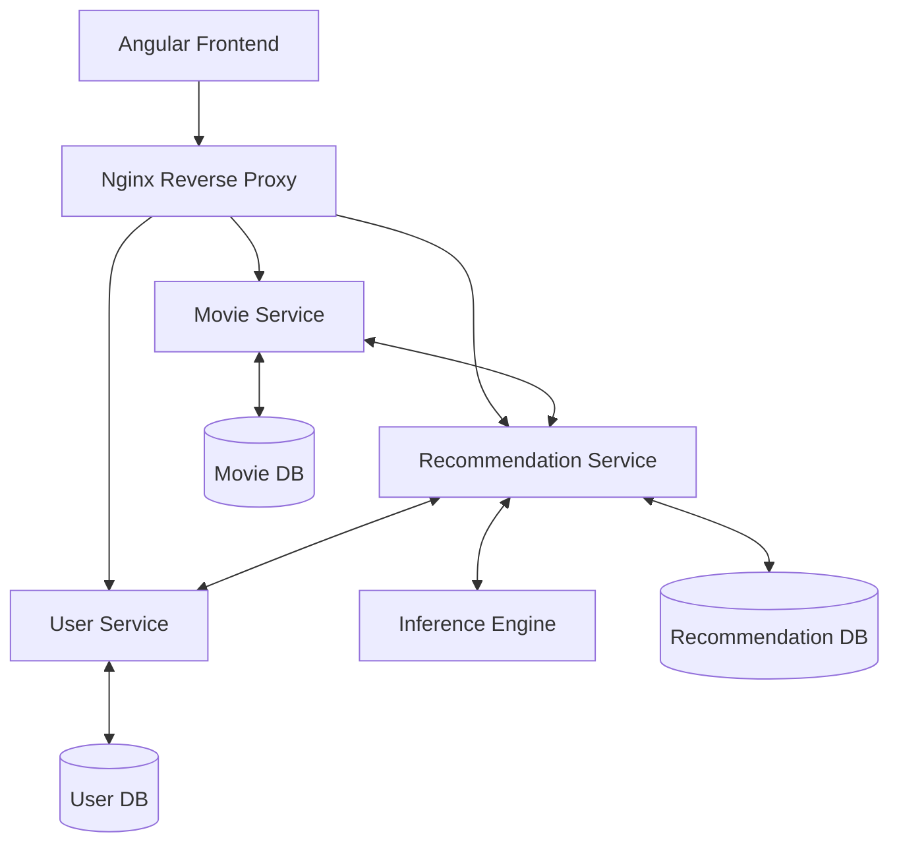

# Project Specification

## Overview

- Agreed working identity: g15 - AI-powered Movie Recommendation Hub, PSIA group 15.
- Purpose: build an original, functional movie recommendation application while demonstrating reproducible public-cloud microservices deployment, AI integration, and operations tooling.
- Primary users: people who want movie recommendations based on their interests and who browse other profiles to discover interests.
- Delivery stakeholders: the student team and course evaluators reproducing and assessing the solution.
- Stage: accounts and profile/catalog foundation. Login, persistent sessions, private profile pages, default avatar selection, watched-history storage/retrieval, and Movie Service catalog/ingestion are implemented. Watchlists, watched actions, recommendation filters/results, and agent context APIs are implemented. Public profile browsing and movie/user search with privacy controls are implemented. Inference, background generation, and interest editing remain pending.
- Basis: the PSIA assignment text and the team's architecture image supplied during initialization. Requirements below are from that supplied assignment; unresolved engineering choices are not commitments.

## Responsibility and Current Scope

| Team member | Responsibility |
| --- | --- |
| Vasco | Application. |
| Martim | AI and the inference engine. |
| Ricardo | MLOps. |

Application-to-inference integration requires coordination between Vasco and Martim. Detailed task allocation and interfaces between responsibilities remain open. Cloud provider, infrastructure tools, and advanced feature selection are not yet decided. The course deployment and evaluation requirements below remain part of the overall project; documenting them does not assign that work to Vasco. Full names and student numbers still need to be provided for the report.

## Problem

Users need a way to express movie interests and receive personalized suggestions, including recommendations ready at login. The project must support this experience through independent services and a working inference engine, while demonstrating automated deployment and measurable system behavior.

## Goals

- Deliver registration, login, interest profiles, browsing of other users' profiles, and personalized AI recommendations through a normal browser.
- Generate and cache recommendations proactively through a background agent.
- Reproduce both infrastructure provisioning and application deployment with documented automation on public-cloud, self-hosted Kubernetes.
- Expose health and performance metrics and present them in a real-time monitoring dashboard.
- Evaluate throughput and latency under increasing client load and demonstrate a selected advanced feature.

## Scope Boundaries

The assignment prioritizes functionality over visual polish. Build an original application; example applications and deployment procedures are inspiration, not material to reproduce verbatim. Product exclusions beyond this are not yet decided. Managed Kubernetes is explicitly forbidden. Model training, movie streaming, and additional social features are not required by the supplied specification and are not confirmed scope.

## Architecture

The following reproduces the team's intended application topology, not an implemented deployment:

| Component | Intended responsibility |
| --- | --- |
| Frontend | Angular application; serve the browser interface for accounts, profiles, and recommendations. |
| Proxy | Nginx reverse proxy routing frontend API requests to backend services; deployment and Kubernetes ingress arrangement remain undecided. |
| Movie Service | Own movie data and expose it through its service interface. TMDB supplies ingestion data; count-driven ingestion downloads posters locally. Runtime creation validates complete agent-supplied data without external lookups. |
| User Service | Own accounts, authentication, and interest profiles; expose the profile information needed by other services and users. |
| Recommendation Service | Coordinate profile/movie data and inference to produce and retrieve personalized recommendations. |
| Inference Engine | Perform model inference actively used for recommendation requests. Model, hosting, and interface are undecided. |
| Movie, User, and Recommendation databases | Dedicated PostgreSQL 18 database instances, each accessed only by its owning service. User DB has `users`, `user_profiles`, `user_sessions`, `watched_movies`, and `watchlist_movies`, plus cleanup coordination records. Movie DB has `movies` and reset operations. Recommendation DB stores results with auto/user-requested sources. |

The bidirectional links represent service exchanges; protocols and API contracts are not yet decided. Services obtain another service's data through its interface, never through direct access to its database.

Two assignment requirements are absent from the supplied application diagram and must be incorporated into the detailed design:

- A background agent proactively generates and caches profile-based recommendations for login. Whether it runs within the Recommendation Service or as a worker, its scheduling, and cache ownership/freshness rules are not yet decided; its design must preserve database ownership.
- Monitoring and logging cover the application, services, and infrastructure, with a monitoring server and real-time dashboard. Tool selection and deployment topology are not yet decided.

An expected recommendation flow is Angular frontend -> Nginx reverse proxy -> Recommendation Service, which obtains profile and movie information through the owning services, invokes inference, and stores/retrieves recommendation data in its own database. Cache policy and failure handling require further design.

## Requirements

### Functional

1. Users can register and log in.
2. Users can create personalized profiles describing interests and preferences.
3. Users can browse and view other users' profiles to discover interests.
4. Users can request movie recommendations personalized to their profile and preferences; the backend actively queries the inference engine.
5. A background agent proactively produces and caches recommendations, so fresh suggestions are ready on login.
6. All user interactions are available through a normal web browser.
7. The system manages user state and completes its core workflows without crashing.

### Quality and Operations

- Keep backend services independent with one dedicated database instance per service and exclusive service ownership of access.
- Instrument applications and infrastructure for health/status metrics, traceability, performance monitoring, and logs; display metrics in real time.
- Make deployment reproducible from source and documented instructions, minimizing vendor lock-in where practical.
- Measure throughput and latency as the number of clients increases. Numeric performance targets and workload design are not yet decided.
- Authentication uses email/password with Argon2id hashes and seven-day server-side sessions in HttpOnly cookies. Public profile APIs require a session and enforce owner visibility; profiles default public. Data retention and inference failure behavior remain pending.

## Implementation Stages

### Stage I: Base Solution (70% of implementation evaluation)

1. Build a simple local microservices application with the required movie recommendation behavior.
2. Package and deploy its infrastructure locally as containers; Docker Compose is an assignment example, not a confirmed tool choice.
3. Deploy on a public-cloud Kubernetes cluster. Both the self-hosted cluster and application must be deployed entirely through IaC tools. Managed Kubernetes offerings, including GKE, are forbidden.
4. Deploy operations tooling, instrument resources, and provide a monitoring server and real-time dashboard. Prometheus and Grafana are assignment examples, not confirmed choices.

### Stage II: Advanced Solution (30% of implementation evaluation)

The assignment states that implementing one option can achieve the maximum advanced grade. Selection is not yet decided:

- Complete CI/CD: automatically test, package, and deploy the application on every commit.
- DevSecOps: extend basic CI with SAST, container image scanning, and dependency vulnerability checks on every commit.
- Persistent state: use self-hosted storage and/or databases and demonstrate no application state loss after shutting down all VMs and restarting them.
- Automatic scaling: scale with load, consider both vertical and horizontal scaling, and explain tradeoffs and the chosen solution in the report.

## Constraints

- The project represents 50% of the course grade and is sized for three students.
- Use a public-cloud provider; provider, region, budget, and instance sizing are not yet decided. Self-hosted Kubernetes means kubeadm, provisioned with Terraform + Ansible; monitoring is kube-prometheus-stack. Local verification runs on KVM/libvirt VMs.
- Keep regular, attributable contributions from each team member in the group repository; failure can incur grading penalties.
- Do not directly reuse the supplied example applications or reproduce their procedures verbatim.
- Confirmed application stack: Angular 21.2 on Node 24, Nginx reverse proxy, Flask 3.1.3 on Python 3.12 with Psycopg 3.3.6, and three dedicated PostgreSQL 18 databases. npm and pip are the package managers. Martim's inference engine technology remains open.

## Deliverables and Evaluation

The supplied assignment gives a deadline of **Monday, 19 October 2026, 23:59** and discussions on **Friday, 23 October 2026**. Submission timezone and discussion slot are not specified in the supplied text. One group member submits the collaboratively produced deliverables.

| Deliverable | Requirements |
| --- | --- |
| Fenix report | English PDF named `project-g15.pdf`; include names and student numbers of active members and put the video link near the beginning. |
| Report content | Introduction, base system design/architecture, advanced components/deployment methods, and evaluation of throughput/latency as client count increases; include diagrams and reproducible deployment instructions. |
| Report format | At most 5 pages; Times New Roman, Arial, or similar; font size at least 10; side margins 2.0 cm, top/bottom 1.5 cm; single spacing. |
| GitLab source | Final commit pushed to `https://gitlab.rnl.tecnico.ulisboa.pt/psia/groups26/g15`; include all files needed to reproduce the solution, instructional READMEs, diagrams, screenshots, deployment procedures, and web UI usage. Root README must explain the components and full installation/configuration. |
| YouTube video | Collaborative contribution from all members; public or unlisted; at most 10 minutes; at least 1280x720; show deployment through a running production system, application behavior, and the chosen advanced feature. Link near the report's beginning. |

## Success Criteria

- Demonstrate registration, login, interest profiles, browsing other profiles, and AI-generated personalized recommendations in a browser.
- Demonstrate proactive generation and cached recommendations available at login; define and verify freshness once its policy is selected.
- Verify dedicated database instances and exclusive access by each owning service.
- Reproduce the containerized local system and public-cloud self-hosted Kubernetes deployment from the submitted code and instructions, using IaC for cluster and application.
- Show live health/performance metrics and a dashboard, with sufficient instrumentation to investigate behavior.
- Demonstrate the selected advanced option and report throughput/latency measurements under increasing client load.
- Deliver the report, source, and video within the stated constraints, with attributable team contributions.

## Open Questions

- Full names and student numbers for the report, detailed task allocation, branch/review policy, and license.
- Product API protocols; Nginx version, deployment packaging, and deployment arrangement.
- TMDB ingestion credentials/catalog size at run time; inference model/runtime/hosting and model resource needs.
- Cloud provider/region and budget. GCP `europe-southwest1` verified end to end (then destroyed); re-provision with the documented sequence. IaC tools (Terraform + Ansible), self-hosted Kubernetes distribution (kubeadm), and local container tooling (tarball + `ctr import`) are decided; see `infra/README.md`.
- Advanced feature selection and its acceptance demonstration.
- Background agent deployment/schedule, caching/storage boundaries, freshness, and behavior for new or changed profiles.
- Authentication and authorization, profile visibility, data retention, error handling, and numerical reliability/performance targets.
- Monitoring stack (kube-prometheus-stack; logging stack still open), load-test tooling, workload design, and exact deployment/run commands.
